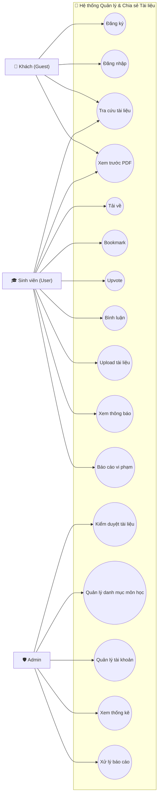
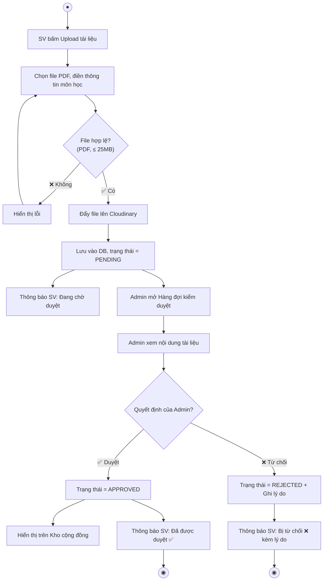
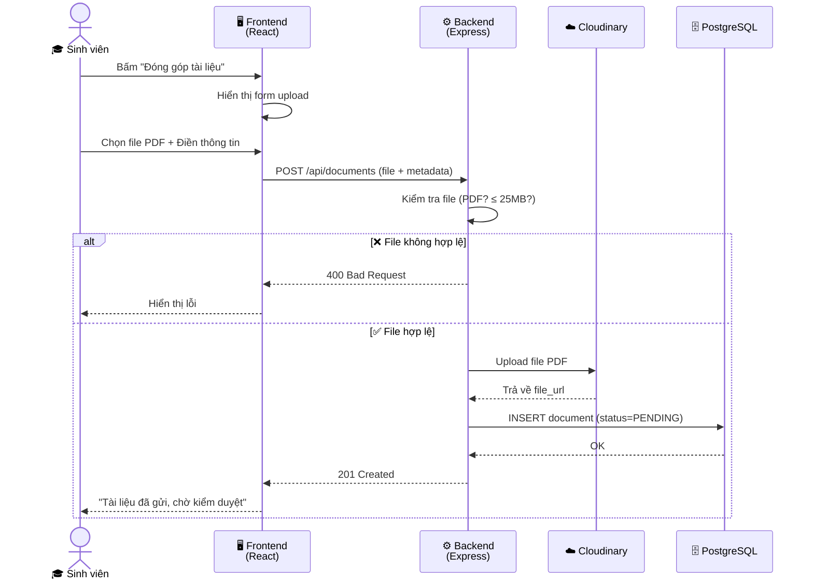

# 🖼️ HƯỚNG DẪN TRỰC QUAN: Mỗi sản phẩm phân tích - thiết kế trông ra sao?

> [!NOTE]
> Tài liệu này giải thích **bằng ngôn ngữ đời thường** và **kèm hình minh họa** để bạn hiểu bản chất từng sản phẩm mà nhóm cần làm trước khi code. Không có gì cao siêu cả!

---

## 1️⃣ SƠ ĐỒ USE CASE (Use Case Diagram)

### Nó là gì? (Giải thích 1 câu)
> **Một tấm bản đồ cho thấy "AI được làm GÌ" trong hệ thống.**

### Trông nó ra sao?
- Bên ngoài có **hình người que** (gọi là Actor — tức là người dùng: Khách, Sinh viên, Admin).
- Bên trong hộp chữ nhật (ranh giới hệ thống) có **các hình elip** (mỗi elip là 1 tính năng).
- Đường nối từ người que đến elip = "Người này ĐƯỢC PHÉP làm tính năng này".

### Sơ đồ mẫu cho đề tài của nhóm:



### Công cụ vẽ:
- **Draw.io** (miễn phí): Vào [app.diagrams.net](https://app.diagrams.net), chọn template UML, kéo thả hình người que và hình elip.
- Vẽ xong xuất ra file PNG chèn vào báo cáo Word.

### Mục đích:
- Thầy cô nhìn vào **1 tấm hình duy nhất** là thấy toàn cảnh hệ thống có bao nhiêu tính năng, ai dùng được tính năng nào.

---

## 2️⃣ ĐẶC TẢ USE CASE (Use Case Specification)

### Nó là gì? (Giải thích 1 câu)
> **Viết kịch bản chi tiết từng bước cho 1 tính năng, giống viết kịch bản phim vậy.**

### Trông nó ra sao?
Một bảng Word/Google Docs có các hàng cố định:

| Mục | Nội dung ví dụ (UC: Upload tài liệu) |
|---|---|
| **Tên** | Upload tài liệu |
| **Tác nhân** | Sinh viên (đã đăng nhập) |
| **Mô tả** | Sinh viên tải tệp PDF lên để đóng góp vào kho tài liệu |
| **Điều kiện trước** | Sinh viên đã đăng nhập thành công |
| **Luồng chính** | 1. SV bấm nút "Đóng góp tài liệu" → 2. Hệ thống hiện form (Chọn file, Chọn môn, Nhập tên, Nhập mô tả) → 3. SV điền xong bấm "Gửi" → 4. Hệ thống kiểm tra file (PDF? ≤ 25MB?) → 5. Đẩy file lên Cloudinary → 6. Lưu vào DB trạng thái PENDING → 7. Hiện thông báo "Đã gửi, chờ duyệt" |
| **Luồng thay thế** | 4a. File không hợp lệ → Báo lỗi, yêu cầu chọn lại |
| **Điều kiện sau** | Tài liệu nằm trong DB với trạng thái PENDING; Admin thấy trong hàng đợi |

### Cần viết bao nhiêu cái?
- Chỉ cần viết chi tiết cho **5 Use Case quan trọng nhất**: Upload, Kiểm duyệt, Tra cứu, Xem PDF, Đăng ký.
- Còn lại (Bookmark, Upvote, Comment...) chỉ cần ghi tên và mô tả ngắn 1-2 câu.

### Mục đích:
- Khi lập trình, bạn mở bảng này ra là **biết chính xác code phải xử lý những bước nào**, không cần ngồi nghĩ lại.

---

## 3️⃣ SƠ ĐỒ HOẠT ĐỘNG (Activity Diagram)

### Nó là gì? (Giải thích 1 câu)
> **Giống hệt lưu đồ (Flowchart) mà bạn đã học ở môn Nhập môn lập trình!** Vẽ luồng đi của một quy trình: bắt đầu từ đâu, rẽ nhánh Có/Không ở đâu, kết thúc ở đâu.

### Trông nó ra sao?
- **Hình tròn đen** = Điểm bắt đầu.
- **Hình chữ nhật bo góc** = Một hành động (ví dụ: "Sinh viên chọn file PDF").
- **Hình thoi** = Điểm rẽ nhánh quyết định (ví dụ: "File hợp lệ?").
- **Hình tròn đen có viền** = Điểm kết thúc.

### Sơ đồ mẫu: Luồng Upload → Kiểm duyệt → Thông báo



### Cần vẽ bao nhiêu cái?
- **2 đến 3 sơ đồ** là đủ:
  1. Luồng Upload → Kiểm duyệt → Thông báo (ở trên).
  2. Luồng Tra cứu → Xem trước PDF → Tải về.
  3. Luồng Đăng ký → Đăng nhập.

### Mục đích:
- Thầy cô nhìn vào thấy nhóm **hiểu rõ nghiệp vụ chạy từ đầu đến cuối**, không bị sót bước nào.

---

## 4️⃣ SƠ ĐỒ QUAN HỆ THỰC THỂ - ERD (Entity Relationship Diagram)

### Nó là gì? (Giải thích 1 câu)
> **Bản thiết kế các bảng trong Cơ sở Dữ liệu:** Bảng nào chứa cột gì, bảng nào nối với bảng nào.

### Trông nó ra sao?
- Mỗi **hình chữ nhật** = 1 bảng (Table) trong PostgreSQL.
- Bên trong liệt kê **tên các cột** (id, title, email, status...).
- **Đường nối giữa 2 bảng** = Mối quan hệ (1 User có nhiều Documents = quan hệ 1:N).

### Cách làm cực nhanh với dbdiagram.io:
Vào [dbdiagram.io](https://dbdiagram.io), xóa code mặc định, dán đoạn này vào:

```sql
// ===== HỆ THỐNG CHIA SẺ TÀI LIỆU HỌC TẬP =====

Table users {
  id int [pk, increment]
  email varchar [unique, not null]
  password_hash varchar [not null]
  full_name varchar [not null]
  avatar_url varchar
  role varchar [default: 'USER', note: 'USER hoặc ADMIN']
  is_active boolean [default: true]
  created_at timestamp [default: `now()`]
}

Table categories {
  id int [pk, increment]
  name varchar [not null, note: 'VD: Toán rời rạc, Phương pháp dạy học TH']
  group_name varchar [note: 'VD: Đại cương, Chuyên ngành, Sư phạm']
  semester varchar [note: 'VD: HK1 Năm 2, HK2 Năm 3']
}

Table documents {
  id int [pk, increment]
  title varchar [not null]
  description text
  file_url varchar [not null, note: 'Link file trên Cloudinary']
  file_size int [note: 'Đơn vị: bytes']
  status varchar [default: 'PENDING', note: 'PENDING / APPROVED / REJECTED']
  reject_reason text [note: 'Lý do từ chối (nếu bị reject)']
  download_count int [default: 0]
  uploader_id int [ref: > users.id]
  category_id int [ref: > categories.id]
  created_at timestamp [default: `now()`]
}

Table bookmarks {
  id int [pk, increment]
  user_id int [ref: > users.id]
  document_id int [ref: > documents.id]
  created_at timestamp [default: `now()`]
}

Table upvotes {
  id int [pk, increment]
  user_id int [ref: > users.id]
  document_id int [ref: > documents.id]
  created_at timestamp [default: `now()`]
}

Table comments {
  id int [pk, increment]
  content text [not null]
  user_id int [ref: > users.id]
  document_id int [ref: > documents.id]
  created_at timestamp [default: `now()`]
}

Table notifications {
  id int [pk, increment]
  user_id int [ref: > users.id]
  message text [not null]
  is_read boolean [default: false]
  related_document_id int [ref: > documents.id]
  created_at timestamp [default: `now()`]
}
```

Sau khi dán xong, bên phải màn hình sẽ **tự động vẽ ra sơ đồ ERD rất đẹp** với các đường nối quan hệ giữa các bảng. Bạn bấm nút Export ra PNG để chèn vào báo cáo!

### Mục đích:
- Đây là **bản thiết kế xây nhà cho Database**. Không có ERD thì khi code sẽ không biết bảng nào chứa cột gì, dẫn đến mỗi bạn tự đặt tên cột khác nhau.

---

## 5️⃣ SƠ ĐỒ TUẦN TỰ (Sequence Diagram)

### Nó là gì? (Giải thích 1 câu)
> **Sơ đồ thể hiện thứ tự gửi - nhận dữ liệu giữa các thành phần theo trục thời gian (từ trên xuống dưới).**

### Trông nó ra sao?
- Phía trên có các **cột dọc** (Lifeline): mỗi cột là 1 thành phần (Sinh viên, Frontend, Backend, Cloudinary, Database).
- **Mũi tên ngang** = Một lần gửi dữ liệu từ bên này sang bên kia.
- Đọc từ trên xuống dưới = Theo dòng thời gian.

### Sơ đồ mẫu: Luồng Upload tài liệu



### Khác gì Activity Diagram?
- **Activity Diagram** = Nhìn từ góc "nghiệp vụ người dùng" (Bước 1, Bước 2, rẽ nhánh Có/Không).
- **Sequence Diagram** = Nhìn từ góc "kỹ thuật lập trình" (Frontend gọi Backend, Backend gọi Cloudinary, Backend gọi Database).

### Cần vẽ bao nhiêu cái?
- **2 đến 3 sơ đồ**: Upload tài liệu, Kiểm duyệt tài liệu, Đăng nhập.

### Mục đích:
- Khi lập trình, mỗi bạn trong nhóm nhìn vào sơ đồ này là biết: *"À, Frontend cần gọi API nào, Backend cần gọi Cloudinary trước rồi mới lưu DB sau"*. Không ai phải đoán mò!

---

## 6️⃣ WIREFRAME (Bản phác thảo giao diện)

### Nó là gì? (Giải thích 1 câu)
> **Bản vẽ "khung xương" của giao diện web — chỉ có ô vuông, đường kẻ và chữ, KHÔNG có màu sắc hay hình ảnh đẹp.**

### Trông nó ra sao?
Giống như bạn vẽ trên giấy ô ly:
```
┌─────────────────────────────────────────────────────┐
│  🔍 Tìm kiếm tài liệu...              [Đăng nhập] │
├──────────────┬──────────────────────────────────────┤
│              │                                      │
│  📁 Đại cương│  📄 Đề thi Toán rời rạc   ⭐ 42 ⬆  │
│  📁 Cơ sở   │  📄 Slide Kiến trúc MT     ⭐ 38 ⬆  │
│  📁 Chuyên   │  📄 Giáo án PPDH TH       ⭐ 29 ⬆  │
│  📁 Sư phạm │  📄 BT lớn Lập trình C++  ⭐ 25 ⬆  │
│              │                                      │
└──────────────┴──────────────────────────────────────┘
```

### Công cụ vẽ:
- **Figma** (miễn phí) — Kéo thả hình chữ nhật, gõ chữ vào.
- **Draw.io** — Cũng được, dùng hình chữ nhật cơ bản.
- **Vẽ tay trên giấy rồi chụp ảnh** — Thầy cô hoàn toàn chấp nhận ở giai đoạn này!

### Cần vẽ bao nhiêu màn hình?
- **5 đến 7 màn hình chính:**
  1. Trang chủ (Danh mục môn + Danh sách tài liệu).
  2. Trang đọc tài liệu (PDF Preview + Nút Download/Bookmark/Upvote + Bình luận).
  3. Trang Upload tài liệu (Form nhập liệu).
  4. Trang Bookmark cá nhân.
  5. Trang Admin - Kiểm duyệt.
  6. Trang Admin - Quản lý danh mục.
  7. Trang Đăng nhập / Đăng ký.

### Mục đích:
- Trước khi code giao diện, **cả nhóm thống nhất bố cục** để không xảy ra tình trạng: bạn A làm thanh menu bên trái, bạn B lại làm thanh menu phía trên.

---

## 7️⃣ BẢNG THIẾT KẾ API ENDPOINTS

### Nó là gì? (Giải thích 1 câu)
> **Danh sách các "đường link nội bộ" mà Frontend sẽ gọi tới Backend để lấy/gửi dữ liệu.** Giống như một cuốn danh bạ điện thoại: muốn lấy danh sách tài liệu thì "gọi số" nào, muốn upload file thì "gọi số" nào.

### Trông nó ra sao?
Một bảng Word/Google Docs đơn giản:

| Hành động | Phương thức | Đường link API | Ai được gọi? |
|---|---|---|---|
| Đăng ký | POST | `/api/auth/register` | Khách |
| Đăng nhập | POST | `/api/auth/login` | Khách |
| Xem danh sách tài liệu | GET | `/api/documents` | Tất cả |
| Xem chi tiết 1 tài liệu | GET | `/api/documents/:id` | Tất cả |
| Upload tài liệu | POST | `/api/documents` | User |
| Duyệt tài liệu | PUT | `/api/admin/documents/:id/approve` | Admin |
| Từ chối tài liệu | PUT | `/api/admin/documents/:id/reject` | Admin |
| Upvote | POST | `/api/documents/:id/upvote` | User |
| Bookmark | POST | `/api/documents/:id/bookmark` | User |
| Xem bình luận | GET | `/api/documents/:id/comments` | Tất cả |
| Đăng bình luận | POST | `/api/documents/:id/comments` | User |
| Xem thông báo | GET | `/api/notifications` | User |
| Xem danh mục môn học | GET | `/api/categories` | Tất cả |
| Thống kê (Dashboard) | GET | `/api/admin/stats` | Admin |

### Mục đích:
- Bạn làm Frontend và bạn làm Backend **nhìn vào bảng này là biết ngay**: tui gọi đường link nào, gửi dữ liệu gì, và sẽ nhận lại kết quả dạng gì. Không ai phải hỏi "ê ông ơi API tên gì vậy?" nữa.

---

## 📋 TÓM TẮT: THỨ TỰ LÀM VIỆC KHUYÊN DÙNG

| Bước | Sản phẩm | Thời gian ước tính | Ai làm? |
|---|---|---|---|
| 1 | Khảo sát Google Form + Phân tích Studocu | 1 buổi chiều | 1 bạn |
| 2 | Bảng Yêu cầu chức năng (SRS) | 1 buổi tối | Cả nhóm thảo luận |
| 3 | Sơ đồ Use Case (Draw.io) | 1–2 giờ | 1 bạn vẽ |
| 4 | Đặc tả 5 Use Case chi tiết | 1 buổi tối | Chia mỗi bạn viết 1 UC |
| 5 | Activity Diagram (2–3 cái) | 1–2 giờ | 1 bạn vẽ |
| 6 | ERD trên dbdiagram.io | 30 phút (copy code ở trên dán vào!) | 1 bạn |
| 7 | Bảng API Endpoints | 1 giờ | 1 bạn |
| 8 | Sequence Diagram (2–3 cái) | 1–2 giờ | 1 bạn vẽ |
| 9 | Wireframe (5–7 màn hình) | 1 buổi tối | 1–2 bạn |
| 10 | Setup GitHub + Trello + AGENTS.md | 1 giờ | Nhóm trưởng |

> [!TIP]
> **Tổng cộng: Khoảng 3–4 ngày làm việc** (nếu chia đều cho 5 người, mỗi người chỉ mất khoảng 1 buổi tối). Sau đó cả nhóm bắt tay vào code với sự hỗ trợ của Antigravity, mọi thứ sẽ cực kỳ trơn tru vì ai cũng đã có "bản đồ" trong tay!
