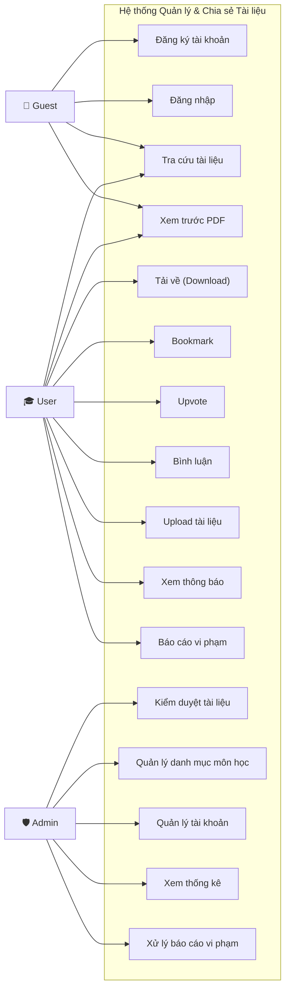
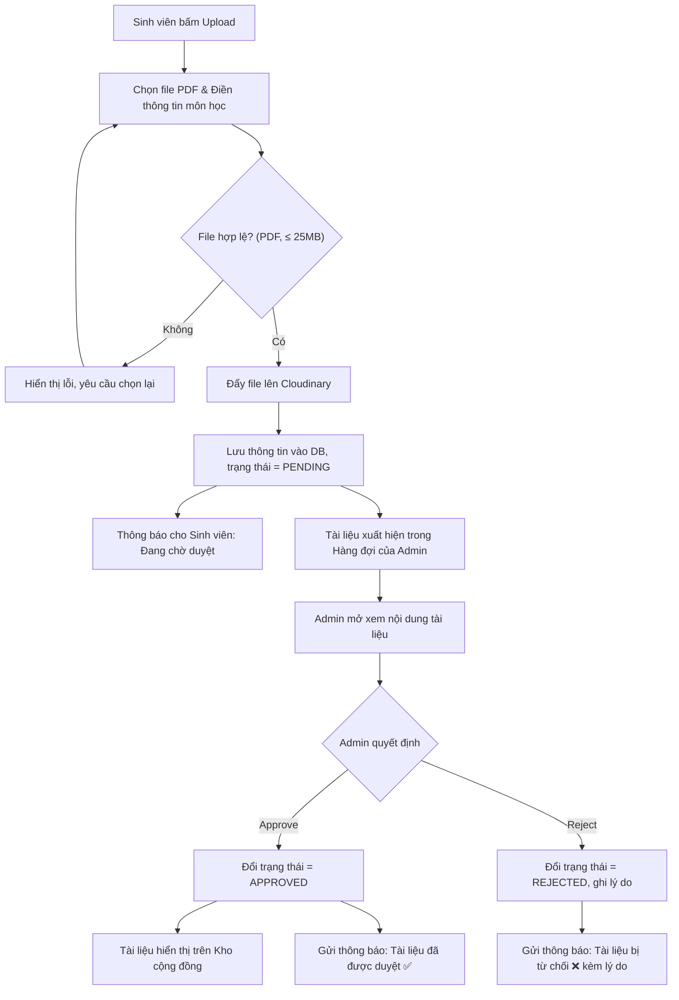
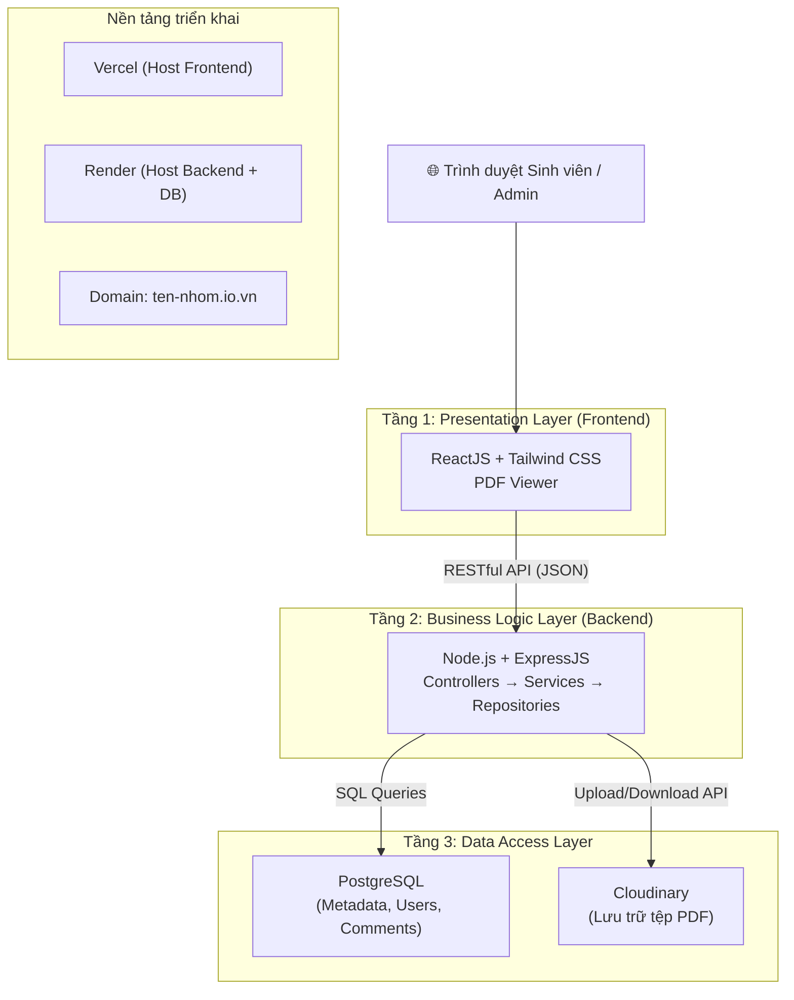
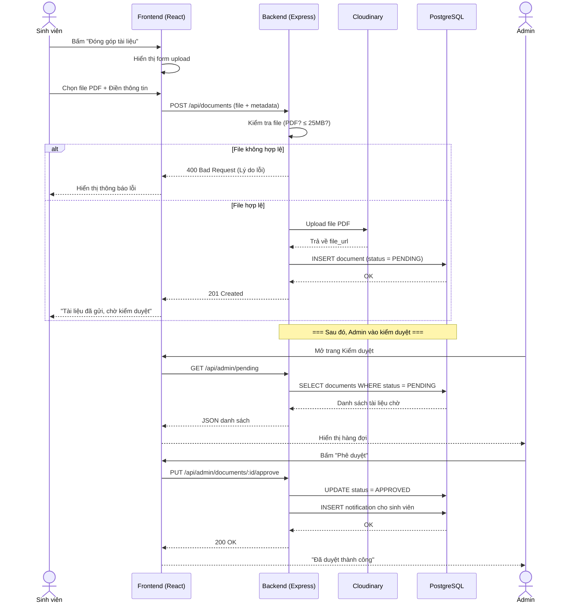

# 🗺️ LỘ TRÌNH PHÂN TÍCH & THIẾT KẾ TRƯỚC KHI LẬP TRÌNH

**Đề tài:** Hệ thống Quản lý và Chia sẻ Tài liệu Học tập cho Sinh viên ngành Sư phạm Tin học

> [!IMPORTANT]
> Tất cả các sản phẩm dưới đây phải **hoàn thành TRƯỚC KHI viết bất kỳ dòng code nào**. Đây chính là phần chiếm trọng số lớn nhất trong bài đánh giá cuối kỳ (Tiểu luận/Khóa luận theo Rubric).

---

## GIAI ĐOẠN 1: KHẢO SÁT & XÁC ĐỊNH YÊU CẦU (Chủ đề 2)

*Mục tiêu: Trả lời câu hỏi "Hệ thống CẦN LÀM GÌ?" — Thu thập bằng chứng từ người dùng thật, không phải tự nghĩ ra.*

### ✅ Việc 1.1: Khảo sát thực tế người dùng (User Survey)

**Sản phẩm cần nộp:** File Google Form + Bảng tổng hợp kết quả khảo sát.

**Cách làm:**
- Tạo 1 form Google Form (khoảng 8–12 câu hỏi), gửi cho các bạn sinh viên **cùng ngành Sư phạm Tin học** (các khóa K49, K50, K51...).
- **Các câu hỏi mẫu nên đặt:**
  1. Bạn thường tìm tài liệu học tập ở đâu? (Nhóm Facebook / Zalo / Google / Hỏi bạn bè?)
  2. Bạn đã bao giờ bị mất hoặc không tìm lại được một tài liệu quan trọng chưa?
  3. Bạn có sẵn lòng chia sẻ đề thi / giáo án cũ lên một nền tảng chung không?
  4. Khi tìm tài liệu, bạn muốn lọc theo tiêu chí nào? (Môn học / Giảng viên / Kỳ học / Loại tài liệu?)
  5. Bạn có muốn xem trước tài liệu trên web trước khi quyết định tải về không?
  6. Bạn nghĩ tài liệu do sinh viên chia sẻ có cần được kiểm duyệt trước khi công khai không?
- Thu về tối thiểu **20–30 phản hồi** (đủ để có dữ liệu thuyết phục trong báo cáo).
- Tổng hợp kết quả thành **biểu đồ tròn / biểu đồ cột** để chèn vào tài liệu phân tích.

> [!TIP]
> Chụp screenshot biểu đồ kết quả khảo sát đưa vào báo cáo là cực kỳ ăn điểm! Thầy cô thấy nhóm có bằng chứng thực tế chứ không phải "ngồi phòng tự nghĩ ra yêu cầu".

---

### ✅ Việc 1.2: Phân tích sản phẩm tương tự (Competitor Analysis)

**Sản phẩm cần nộp:** Bảng so sánh tính năng giữa sản phẩm tham khảo và hệ thống dự kiến.

**Cách làm:**
- Lên **Studocu.com** (hoặc các web tương tự: TaiLieu.vn, 123doc.net) chụp màn hình giao diện.
- Lập bảng so sánh:

| Tính năng | Studocu | TaiLieu.vn | Hệ thống của nhóm |
|---|---|---|---|
| Upload tài liệu | ✅ | ✅ | ✅ |
| Xem trước PDF trực tuyến | ✅ (Blur trang sau) | ❌ | ✅ (Toàn văn) |
| Kiểm duyệt trước khi công khai | ❌ (Tự động) | ❌ | ✅ (Admin duyệt thủ công) |
| Phân loại theo chương trình đào tạo SPTH | ❌ | ❌ | ✅ (Đại cương / Chuyên ngành / Sư phạm) |
| Bookmark & Upvote | ✅ | ❌ | ✅ |
| Bình luận hỏi đáp | ✅ | ❌ | ✅ |
| Thông báo kết quả kiểm duyệt | ❌ | ❌ | ✅ |

> Bảng này giúp thầy cô thấy rõ: nhóm không "sao chép" Studocu, mà **có giá trị khác biệt riêng** (kiểm duyệt chất lượng + bám sát chương trình đào tạo ngành SPTH).

---

### ✅ Việc 1.3: Tài liệu Đặc tả Yêu cầu Phần mềm (SRS - Software Requirements Specification)

**Sản phẩm cần nộp:** File Word/PDF tài liệu SRS.

**Nội dung chính gồm 2 phần:**

#### A. Yêu cầu chức năng (Functional Requirements):
*Liệt kê dưới dạng bảng, đánh mã số rõ ràng:*

| Mã | Tên yêu cầu | Mô tả | Vai trò |
|---|---|---|---|
| FR-01 | Đăng ký tài khoản | Sinh viên đăng ký bằng email trường (@student.hcmue.edu.vn) | Guest |
| FR-02 | Đăng nhập / Đăng xuất | Xác thực bằng email và mật khẩu, cấp token phiên làm việc | Guest |
| FR-03 | Tra cứu tài liệu | Tìm kiếm theo từ khóa, lọc theo danh mục môn học, giảng viên, loại tài liệu | Guest, User |
| FR-04 | Xem trước tài liệu (PDF Preview) | Hiển thị toàn văn nội dung PDF trực tiếp trên trình duyệt | Guest (giới hạn), User |
| FR-05 | Tải tài liệu về máy (Download) | Tải tệp PDF gốc về máy cá nhân | User |
| FR-06 | Lưu tài liệu yêu thích (Bookmark) | Thêm/xóa tài liệu vào bộ sưu tập cá nhân | User |
| FR-07 | Đánh giá tài liệu (Upvote) | Bấm nút Upvote để đánh giá chất lượng tài liệu | User |
| FR-08 | Bình luận trao đổi (Comment) | Đăng bình luận hỏi đáp dưới tài liệu | User |
| FR-09 | Tải lên tài liệu (Upload) | Đóng góp tệp PDF kèm thông tin môn học, tài liệu chuyển sang trạng thái Pending | User |
| FR-10 | Kiểm duyệt tài liệu | Admin xem xét tài liệu trong hàng đợi, phê duyệt hoặc từ chối kèm lý do | Admin |
| FR-11 | Thông báo kết quả kiểm duyệt | Hệ thống tự động gửi thông báo đến tài khoản sinh viên khi tài liệu được duyệt/từ chối | System |
| FR-12 | Quản lý danh mục môn học | Thêm, sửa, xóa danh mục môn học theo chương trình đào tạo | Admin |
| FR-13 | Quản lý tài khoản người dùng | Xem danh sách, khóa/mở khóa tài khoản thành viên | Admin |
| FR-14 | Báo cáo vi phạm | Sinh viên gửi báo cáo tài liệu/bình luận vi phạm, Admin tiếp nhận xử lý | User, Admin |
| FR-15 | Thống kê tổng quan (Dashboard) | Xem biểu đồ thống kê lượng tài liệu, lượt tải, tương tác | Admin |

#### B. Yêu cầu phi chức năng (Non-Functional Requirements):

| Mã | Loại | Mô tả |
|---|---|---|
| NFR-01 | Hiệu năng | Trang web phải tải xong trong vòng 3 giây trên kết nối 4G thông thường |
| NFR-02 | Bảo mật | Mật khẩu phải được băm (hash) trước khi lưu vào CSDL; File upload phải kiểm tra định dạng MIME-type |
| NFR-03 | Tương thích | Giao diện hỗ trợ tốt trên cả máy tính và điện thoại di động (Responsive) |
| NFR-04 | Giới hạn | Kích thước tệp upload tối đa 25MB/tệp; chỉ chấp nhận định dạng PDF |
| NFR-05 | Khả dụng | Hệ thống được triển khai trực tuyến 24/7 trên nền tảng đám mây (Vercel + Render) |

---

## GIAI ĐOẠN 2: PHÂN TÍCH PHẦN MỀM (Chủ đề 3)

*Mục tiêu: Trả lời câu hỏi "AI làm GÌ trong hệ thống?" — Mô hình hóa các tác nhân và hành vi bằng sơ đồ UML.*

### ✅ Việc 2.1: Sơ đồ Use Case (Use Case Diagram)

**Sản phẩm cần nộp:** 1 sơ đồ Use Case tổng quan của toàn hệ thống.

**Công cụ vẽ:** Draw.io (miễn phí, xuất ra hình PNG/PDF dễ dàng chèn vào báo cáo).

**Nội dung sơ đồ:**
- **3 Actor (Tác nhân):** Guest (Khách), User (Sinh viên), Admin (Quản trị viên).
- **Các Use Case chính (hình Ellipse):**
  - Guest: Đăng ký, Đăng nhập, Tra cứu tài liệu, Xem trước PDF (giới hạn).
  - User: Tải về, Bookmark, Upvote, Bình luận, Upload tài liệu, Xem thông báo, Báo cáo vi phạm.
  - Admin: Kiểm duyệt tài liệu, Quản lý danh mục môn học, Xử lý báo cáo vi phạm, Quản lý tài khoản, Xem thống kê.
- **Các quan hệ:**
  - Guest ---<<extend>>---> User (Đăng nhập xong thì được mở rộng quyền).
  - Upload tài liệu ---<<include>>---> Kiểm duyệt tài liệu (Upload bắt buộc kéo theo kiểm duyệt).



> [!NOTE]
> Sơ đồ Mermaid ở trên chỉ để nhóm tham khảo bố cục. Khi nộp báo cáo chính thức, nhóm nên vẽ lại bằng **Draw.io** theo chuẩn UML (hình người que, hình elip, đường nối có mũi tên <<include>> / <<extend>>) để đúng ký hiệu học thuật.

---

### ✅ Việc 2.2: Đặc tả Use Case chi tiết (Use Case Specification)

**Sản phẩm cần nộp:** Bảng đặc tả chi tiết cho **5–7 Use Case quan trọng nhất** (không cần đặc tả hết 15 cái).

**Các Use Case BẮT BUỘC phải đặc tả chi tiết** (vì đây là lõi nghiệp vụ, thầy sẽ hỏi sâu):

1. **UC-09: Upload tài liệu** (Luồng phức tạp nhất: validate file → upload Cloudinary → lưu DB → chuyển trạng thái Pending)
2. **UC-12: Kiểm duyệt tài liệu** (Luồng Admin: xem file → Approve/Reject → gửi thông báo)
3. **UC-03: Tra cứu tài liệu** (Luồng tìm kiếm: chọn danh mục → lọc → hiển thị kết quả)
4. **UC-04: Xem trước PDF** (Luồng kỹ thuật: gọi Cloudinary lấy URL → render PDF trên web)
5. **UC-01: Đăng ký tài khoản** (Luồng Auth: validate email → băm mật khẩu → lưu DB)

**Mẫu đặc tả 1 Use Case (ví dụ UC-09: Upload tài liệu):**

| Mục | Nội dung |
|---|---|
| **Tên UC** | Upload tài liệu |
| **Mã số** | UC-09 |
| **Tác nhân** | User (Sinh viên đã đăng nhập) |
| **Mô tả** | Sinh viên tải lên 1 tệp PDF kèm thông tin mô tả để đóng góp vào kho tài liệu cộng đồng |
| **Điều kiện tiên quyết** | Sinh viên đã đăng nhập thành công |
| **Luồng chính** | 1. Sinh viên bấm nút "Đóng góp tài liệu". → 2. Hệ thống hiển thị form: Chọn file PDF, Chọn danh mục môn học, Nhập tên tài liệu, Nhập mô tả ngắn. → 3. Sinh viên điền đầy đủ thông tin và bấm "Gửi". → 4. Hệ thống kiểm tra: File phải là PDF, dung lượng ≤ 25MB. → 5. Hệ thống đẩy file lên Cloudinary, nhận về URL. → 6. Hệ thống lưu thông tin tài liệu vào CSDL với trạng thái = PENDING. → 7. Hệ thống hiển thị thông báo: "Tài liệu đã được gửi, vui lòng chờ kiểm duyệt." |
| **Luồng thay thế** | 4a. File không phải PDF hoặc > 25MB → Hiển thị lỗi, yêu cầu chọn lại file. |
| **Điều kiện sau** | Tài liệu được lưu trong CSDL với trạng thái PENDING; Admin nhìn thấy tài liệu mới trong Hàng đợi kiểm duyệt |

---

### ✅ Việc 2.3: Sơ đồ Hoạt động (Activity Diagram)

**Sản phẩm cần nộp:** 2–3 sơ đồ Activity Diagram cho các luồng nghiệp vụ phức tạp nhất.

**Các luồng BẮT BUỘC phải vẽ Activity Diagram:**

1. **Luồng Upload → Kiểm duyệt → Thông báo:** Đây là luồng xương sống của toàn bộ hệ thống.



2. **Luồng Tra cứu → Xem trước → Tải về:** Luồng trải nghiệm chính của sinh viên.
3. **Luồng Đăng ký → Đăng nhập → Phân quyền:** Luồng xác thực cơ bản.

---

## GIAI ĐOẠN 3: THIẾT KẾ PHẦN MỀM (Chủ đề 4)

*Mục tiêu: Trả lời câu hỏi "Hệ thống được XÂY DỰNG NHƯ THẾ NÀO?" — Thiết kế kiến trúc, cấu trúc dữ liệu và giao diện.*

### ✅ Việc 3.1: Sơ đồ Kiến trúc Hệ thống (System Architecture Diagram)

**Sản phẩm cần nộp:** 1 sơ đồ kiến trúc tổng quan 3 tầng.



---

### ✅ Việc 3.2: Thiết kế Cơ sở Dữ liệu — Sơ đồ ERD (Entity Relationship Diagram)

**Sản phẩm cần nộp:** 1 sơ đồ ERD đầy đủ, vẽ bằng **dbdiagram.io** (đúng công cụ trên slide của thầy).

**Công cụ:** [dbdiagram.io](https://dbdiagram.io) — Gõ code DBML đơn giản, nó tự vẽ ra sơ đồ ERD cực đẹp, xuất ra PNG/PDF.

**Các bảng (Entities) cần thiết:**

```
┌────────────────┐     ┌──────────────────────┐     ┌──────────────┐
│     users      │     │      documents       │     │  categories  │
├────────────────┤     ├──────────────────────┤     ├──────────────┤
│ id (PK)        │1───n│ id (PK)              │n───1│ id (PK)      │
│ email          │     │ title                │     │ name         │
│ password_hash  │     │ description          │     │ group_name   │
│ full_name      │     │ file_url             │     │ semester     │
│ avatar_url     │     │ file_size            │     └──────────────┘
│ role           │     │ status (PENDING/     │
│ is_active      │     │   APPROVED/REJECTED) │
│ created_at     │     │ reject_reason        │
└────────────────┘     │ download_count       │
        │1             │ uploader_id (FK)     │
        │              │ category_id (FK)     │
        │              │ created_at           │
        │              └──────────────────────┘
        │                         │1
        │                         │
   ┌────┴─────┐    ┌──────────┐   ├──────────────┐   ┌────────────────┐
   │n         │n   │n         │   │n             │   │n               │
┌──────────┐ ┌──────────┐ ┌──────────┐ ┌───────────────────┐
│bookmarks │ │ upvotes  │ │ comments │ │  notifications    │
├──────────┤ ├──────────┤ ├──────────┤ ├───────────────────┤
│ id (PK)  │ │ id (PK)  │ │ id (PK)  │ │ id (PK)           │
│ user_id  │ │ user_id  │ │ user_id  │ │ user_id (FK)      │
│ doc_id   │ │ doc_id   │ │ doc_id   │ │ message            │
│ created  │ │ created  │ │ content  │ │ is_read            │
└──────────┘ └──────────┘ │ created  │ │ related_doc_id     │
                          └──────────┘ │ created_at         │
                                       └───────────────────┘
```

**Ghi chú quan hệ:**
- 1 User có thể upload nhiều Documents (1:N).
- 1 Category chứa nhiều Documents (1:N).
- 1 User có thể bookmark nhiều Documents (N:N qua bảng bookmarks).
- 1 User có thể upvote nhiều Documents (N:N qua bảng upvotes).
- 1 Document có nhiều Comments (1:N).
- 1 User có nhiều Notifications (1:N).

**Tổng cộng: 6 bảng** — Vừa đủ để thể hiện toàn bộ nghiệp vụ mà không bị cồng kềnh.

---

### ✅ Việc 3.3: Thiết kế API (API Contract / Endpoints)

**Sản phẩm cần nộp:** Bảng danh sách các đường link API mà Frontend sẽ gọi tới Backend.

| Nhóm | Method | Endpoint | Mô tả | Quyền |
|---|---|---|---|---|
| **Auth** | POST | `/api/auth/register` | Đăng ký tài khoản mới | Guest |
| | POST | `/api/auth/login` | Đăng nhập, nhận token | Guest |
| **Documents** | GET | `/api/documents` | Lấy danh sách tài liệu đã duyệt (có lọc, phân trang) | All |
| | GET | `/api/documents/:id` | Xem chi tiết 1 tài liệu | All |
| | POST | `/api/documents` | Upload tài liệu mới (kèm file PDF) | User |
| | GET | `/api/documents/my-uploads` | Xem danh sách tài liệu mình đã tải lên | User |
| **Moderation** | GET | `/api/admin/pending` | Lấy danh sách tài liệu đang chờ duyệt | Admin |
| | PUT | `/api/admin/documents/:id/approve` | Phê duyệt tài liệu | Admin |
| | PUT | `/api/admin/documents/:id/reject` | Từ chối tài liệu (kèm lý do) | Admin |
| **Interaction** | POST | `/api/documents/:id/upvote` | Upvote / Bỏ upvote tài liệu | User |
| | POST | `/api/documents/:id/bookmark` | Bookmark / Bỏ bookmark tài liệu | User |
| | GET | `/api/bookmarks` | Lấy danh sách tài liệu đã bookmark | User |
| | POST | `/api/documents/:id/comments` | Đăng bình luận | User |
| | GET | `/api/documents/:id/comments` | Lấy danh sách bình luận của tài liệu | All |
| **Notifications** | GET | `/api/notifications` | Lấy danh sách thông báo | User |
| | PUT | `/api/notifications/:id/read` | Đánh dấu đã đọc | User |
| **Categories** | GET | `/api/categories` | Lấy danh mục môn học | All |
| | POST | `/api/categories` | Thêm danh mục mới | Admin |
| **Admin** | GET | `/api/admin/users` | Danh sách tài khoản | Admin |
| | GET | `/api/admin/stats` | Thống kê tổng quan | Admin |
| | GET | `/api/admin/reports` | Danh sách báo cáo vi phạm | Admin |

---

### ✅ Việc 3.4: Sơ đồ Tuần tự (Sequence Diagram)

**Sản phẩm cần nộp:** 2–3 sơ đồ Sequence Diagram cho các luồng nghiệp vụ phức tạp nhất.

**Luồng BẮT BUỘC phải vẽ Sequence Diagram:**

#### Luồng "Upload tài liệu → Kiểm duyệt → Thông báo":



---

### ✅ Việc 3.5: Thiết kế Giao diện (UI Wireframe / Mockup)

**Sản phẩm cần nộp:** Bản phác thảo khung dây (Wireframe) cho **5–7 màn hình chính**.

**Công cụ:** Figma (miễn phí) hoặc Draw.io hoặc vẽ tay trên giấy rồi chụp ảnh.

**Các màn hình BẮT BUỘC phải thiết kế:**
1. **Trang chủ (Home):** Thanh tìm kiếm + Danh mục môn học bên trái + Danh sách tài liệu nổi bật.
2. **Trang đọc tài liệu (Document Viewer):** Khung PDF Preview chiếm phần lớn + Thông tin tài liệu + Nút Download/Bookmark/Upvote + Khu vực bình luận bên dưới.
3. **Trang Upload tài liệu:** Form nhập liệu (Chọn file, Tên, Môn học, Mô tả).
4. **Trang Bookmark cá nhân:** Danh sách các tài liệu đã lưu.
5. **Trang Admin - Kiểm duyệt (Pending Queue):** Bảng danh sách tài liệu chờ duyệt + Nút Approve/Reject.
6. **Trang Admin - Quản lý danh mục môn học.**
7. **Trang Đăng nhập / Đăng ký.**

> [!TIP]
> Không cần thiết kế giao diện quá chi tiết ở giai đoạn này. Chỉ cần vẽ **khung dây (wireframe)** thể hiện rõ bố cục các thành phần trên trang. Khi vào giai đoạn lập trình, Antigravity sẽ giúp nhóm hoàn thiện giao diện chi tiết đẹp mắt.

---

## GIAI ĐOẠN 4: CHUẨN BỊ HẠ TẦNG DỰ ÁN (Trước khi viết dòng code đầu tiên)

*Mục tiêu: Chuẩn bị toàn bộ "sân bãi" để cả nhóm 5 người bắt đầu code mà không bị loạn.*

### ✅ Việc 4.1: Khởi tạo GitHub Repository
- Tạo repo trên GitHub, thiết lập file `.gitignore`, `README.md`.
- Bật **Branch Protection Rules** trên nhánh `main` (bắt buộc tạo PR, nhóm trưởng duyệt mới được merge).

### ✅ Việc 4.2: Tạo file AGENTS.md
- Đưa toàn bộ quy chuẩn kiến trúc, naming convention, stack công nghệ vào file `AGENTS.md` tại thư mục gốc.
- Push lên GitHub để tất cả thành viên pull về, Antigravity trên máy ai cũng đọc được.

### ✅ Việc 4.3: Thiết lập bảng Trello (Scrum Board)
- Tạo bảng Trello với các cột: `Product Backlog` → `Sprint Backlog` → `In Progress` → `Testing` → `Done`.
- Tạo thẻ (Card) cho từng tính năng dựa trên bảng Yêu cầu chức năng (FR-01 đến FR-15).
- Gắn tên thành viên phụ trách vào từng thẻ.

### ✅ Việc 4.4: Đăng ký tài khoản các dịch vụ
- **Cloudinary:** Tạo project mới (hoặc dùng lại từ Vectoria), lấy API key.
- **Supabase hoặc Neon.tech:** Tạo database PostgreSQL miễn phí, lấy Connection String.
- **Vercel:** Kết nối với GitHub repo.
- **Render:** Tạo Web Service cho Backend, kết nối GitHub repo.

---

## 📋 TỔNG KẾT: CHECKLIST CÁC SẢN PHẨM PHẢI CÓ TRƯỚC KHI CODE

| # | Sản phẩm | Công cụ đề xuất | Trạng thái |
|---|---|---|---|
| 1 | Bảng khảo sát người dùng + Biểu đồ kết quả | Google Form + Google Sheets | ☐ |
| 2 | Bảng so sánh đối thủ (Studocu, TaiLieu.vn) | Google Docs / Word | ☐ |
| 3 | Tài liệu SRS (Yêu cầu chức năng & phi chức năng) | Google Docs / Word | ☐ |
| 4 | Sơ đồ Use Case + Đặc tả 5 Use Case chi tiết | Draw.io | ☐ |
| 5 | Sơ đồ Activity Diagram (2–3 luồng chính) | Draw.io | ☐ |
| 6 | Sơ đồ Kiến trúc hệ thống 3 tầng | Draw.io | ☐ |
| 7 | Sơ đồ ERD (6 bảng) | dbdiagram.io | ☐ |
| 8 | Bảng thiết kế API Endpoints | Google Docs / Word | ☐ |
| 9 | Sơ đồ Sequence Diagram (2–3 luồng) | Draw.io / Mermaid | ☐ |
| 10 | Wireframe giao diện (5–7 màn hình) | Figma / Draw.io / Vẽ tay | ☐ |
| 11 | GitHub repo + Branch Protection + AGENTS.md | GitHub | ☐ |
| 12 | Bảng Trello (Scrum Board) + Phân công Sprint 1 | Trello | ☐ |
| 13 | Tài khoản Cloudinary + PostgreSQL + Vercel + Render | Các nền tảng cloud | ☐ |
